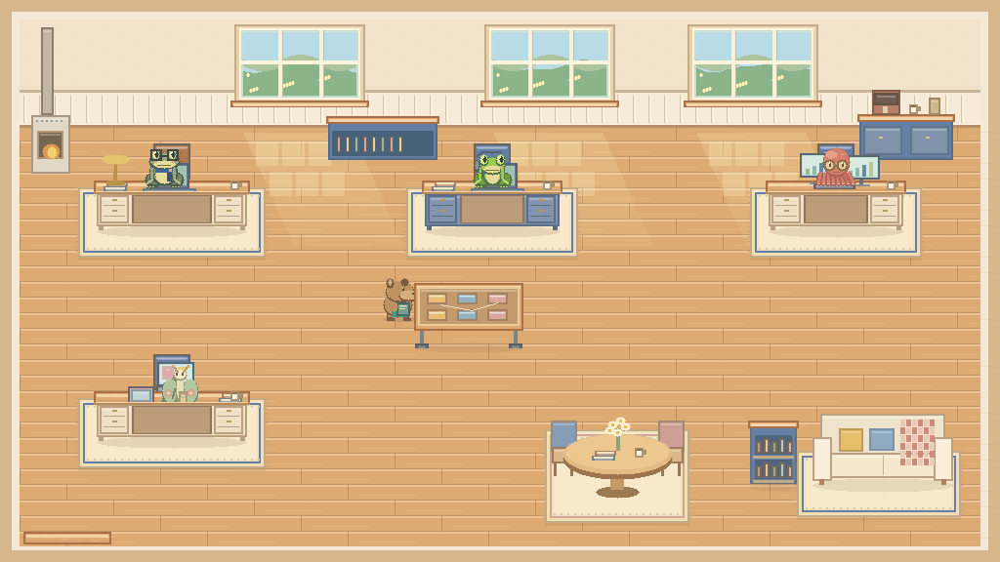

# 성수동이팀장 · 픽셀 오피스

밝은 시골집을 배경으로 다섯 생물 동료가 움직이는 모바일 반응형 시연 웹앱입니다. **개발 검수판이며 실제 AI 직원·업무 중계·고객 분석 시스템과 연결되지 않습니다.**

## 실행

`index.html`을 브라우저로 열면 됩니다. 별도 패키지 설치나 API 키가 필요하지 않습니다.

로컬 HTTP 실행은 Python 3에서 `python serve.py --port 8781` 후 `http://127.0.0.1:8781/`로 접속합니다. 다른 기기의 127.0.0.1은 이 PC와 다릅니다.

## 기능

- 고정 5종: 대표 개구리, 미키 청개구리, 카리나 카피바라, 손지현 루나모스, 유민철 문어.
- 가구를 피하는 4방향 경로와 검수·휴게 구역 이동.
- 바닥·가구 후경·캐릭터·책상 전경·선택 링 분리.
- 직원 선택, 시연 상태 변경, 탭, 확대, 일시정지, 경로 표시.
- 시연 데이터와 화면 애니메이션 필드 분리.
- 브라우저 로컬 저장. 시연 조작은 실제 업무·사업 승인에 반영되지 않습니다.

## 검증과 한계

`node test-core.cjs`: 경로·충돌·정렬·기록 보존 코드 검사 45개.

실제 브라우저 내부 검사에서 1440×900·390×844 프레임 각각 21개 통과. 모바일 실기기 검증이나 독립 시각 품질 승인은 아닙니다. 자세한 범위는 [QA.md](QA.md)를 확인하세요.

픽셀 그래픽은 Canvas 코드로 직접 그립니다. 종별 24셀은 일부 포즈를 공유하는 제한된 애니메이션이며 전 방향의 전문 게임 자산 완성본은 아닙니다. 디자인 디테일 개선을 진행할 개발본입니다.

## 공개 범위

이 저장소에는 실행 소스·직접 제작한 픽셀 자산·공개 시연 데이터만 포함합니다. 내부 업무 문서, 고객 자료, 원본 업무 기록, 대화 기록, 자격증명과 인증정보는 포함하지 않습니다.

GitHub 공개는 소스 열람을 위한 것이며 웹사이트 호스팅이나 Gemini 연결 완료를 의미하지 않습니다. 라이선스는 아직 지정하지 않았습니다.

